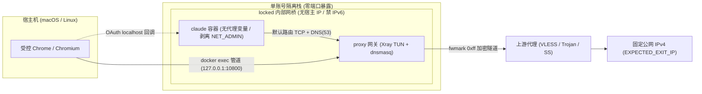

# Claude Docker


面向多账号 **Claude Code** 的透明网络隔离与固定出口运行环境。每个账号独立运行 **`proxy` + `claude` 双容器栈**，零宿主机端口暴露，容器内无代理环境变量、不可见 `tun0`，所有流量强制锁定至指定公网 IPv4 出口（`EXPECTED_EXIT_IP`），异常即刻断流熔断。

> [!NOTE]
> 本项目用于在受控宿主机（macOS Docker Desktop 或 Linux）上隔离不同账号的**网络出口、浏览器登录态与工作目录**，并非面向不可信代码的多租户安全沙箱。宿主机 root、Docker Daemon 与上游代理属于可信边界。

---

## ✨ 核心特性

- **极简双容器栈**：单账号仅由 `proxy`（Xray-core 透明网关）与 `claude`（Ubuntu 24.04 开发环境）组成，不发布任何宿主机端口。
- **零代理特征暴露**：`claude` 容器通过默认路由透明走流，内部无 `HTTP_PROXY` 等代理变量、看不到 `tun0`，启动与 `exec` 时自动剥离网关与子网环境变量。
- **出口强绑定与熔断（Fail-Closed）**：远端强制 IPv4 拨号（`UseIPv4` + TLS Hello 分片防双栈回落 IPv6），启动及运行期持续巡检 `EXPECTED_EXIT_IP`，漂移或断连立即阻断流量，绝不回落宿主机直连。
- **内核级权限锁死**：容器初始化防火墙后，通过 `setpriv` 从内核 Capability Bounding Set 永久移除 `CAP_NET_ADMIN` 与 `CAP_NET_RAW`——保留免密 `sudo` 安装依赖的同时，任何进程均无法篡改路由或 `iptables`。
- **全链路防泄漏**：封堵 Docker 内置 DNS（`127.0.0.11`）、外部直连 DNS/DoT、客户端 QUIC/UDP 及局域网网段；仓库内置敏感凭据与个人路径防泄漏扫描。
- **受控同出口浏览器**：无需容器 GUI，通过单条 `docker exec` 多路复用管道驱动宿主机 Chrome/Chromium，与容器共享同一加密隧道出口、隔离账号 Cookie，并将 OAuth `localhost` 回调自动桥接回容器。

---

## 🏗️ 架构拓扑



---

## 🚀 快速开始

### 环境要求

- **Docker Engine + Compose v2**（宿主内核支持 `/dev/net/tun`）
- **Python 3.11+ & [`uv`](https://docs.astral.sh/uv/)**
- **上游代理节点**：支持 `vless://`（含 XTLS Reality / Vision / SpiderX / PQ）、`trojan://` 或 `ss://`；节点服务器地址须为 **IPv4 字面量**（SNI 填域名），并已知其固定出口 IPv4
- **Google Chrome / Chromium**（可选，仅首次网页 OAuth 授权或访问网页版时需要）

### 1. 创建并配置账号

所有操作统一通过 `scripts/account-env.py` 执行（直接裸跑 `docker compose` 会被拒绝）：

```bash
# 自动分配无冲突 /24 子网，生成 0600 权限的私有配置 accounts/dev.toml
uv run scripts/account-env.py create dev
```

编辑 `accounts/dev.toml`（已被 `.gitignore` 默认拦截），填入真实节点信息：
- `PROXY_URI`：主业务代理 URI
- `DOWNLOAD_PROXY_URI`：下载分流代理 URI（仅有一条节点时填与 `PROXY_URI` 相同即可）
- `EXPECTED_EXIT_IP`：该节点对应的固定公网 IPv4

### 2. 启动并核验隔离栈

```bash
uv run scripts/account-env.py validate dev   # 静态校验配置、子网冲突与仓库防泄漏
uv run scripts/account-env.py up dev         # 构建并启动双容器栈，校验出口就绪
uv run scripts/account-env.py check dev      # 运行端到端隔离、DNS/UDP 防泄漏与出口 IP 检查
```

### 3. 首次授权登录（仅首次需要）

登录态持久保存在 Docker 卷 `<project>_claude-home` 中，完成一次授权后无需重复打开浏览器：

```bash
# 终端 1：启动与 dev 容器同隧道出口、独立 Profile 的受控浏览器
uv run scripts/account-env.py browser dev

# 终端 2：进入容器启动 claude，将登录链接粘贴至上述受控浏览器完成授权（localhost 回调会自动传回容器）
uv run scripts/account-env.py exec dev claude
```

### 4. 日常开发使用

```bash
# 进入隔离容器的交互式 zsh（默认位于挂载的 ~/workspace）
uv run scripts/account-env.py shell dev

# 或直接一步启动 Claude Code
uv run scripts/account-env.py exec dev claude
```

> [!IMPORTANT]
> 请始终通过 `shell` 或 `exec` 进入容器，**不要直接运行裸 `docker exec`**。`claude-exec` 包装器负责自动降权至普通用户、剥离代理拓扑环境变量，并从内核边界摘除 `CAP_NET_ADMIN` / `CAP_NET_RAW`。

---

## 🛠️ 命令速查

```bash
uv run scripts/account-env.py <子命令> [账号] [参数...]
```

| 子命令 | 说明 |
| :--- | :--- |
| `list` | 列出所有已配置账号、专属子网、绑定出口 IP 与容器健康状态 |
| `create <账号>` | 创建 `0600` 权限账号配置、独立 `/24` 子网、专属 `resolv.conf` 与下载分流表 |
| `validate <账号>` | 静态校验 TOML 结构、权限、网络冲突、Compose 配置及 Git 防泄漏规则 |
| `up <账号>` | 构建并启动 `proxy` + `claude` 容器栈（可追加 `--no-build` 等参数） |
| `shell <账号>` | 进入剥离敏感环境变量与网络管理权限的容器 `zsh` |
| `exec <账号> <命令...>` | 在容器安全边界内直接执行命令（例如 `exec dev claude`） |
| `browser <账号> [参数]` | 启动宿主机受控同出口浏览器（详见下方说明） |
| `check <账号>` | 执行全套容器权限、防火墙、DNS/UDP 防泄漏与双栈出口 IP 核验 |
| `net-test <账号>` | 测量代理链路延迟、抖动与大文件下载吞吐 |
| `fail-closed <账号>` | 阻断上游演练（需设 `CONFIRM_FAIL_CLOSED_TEST=yes`），验证断流熔断零直连回落 |
| `repair-network <账号>` | 原地重刷 `claude` 容器内的路由与 `iptables` 规则 |
| `check-leaks` | 扫描 Git 受管与未忽略文件，拦截真实代理 URI、私有 IP 与宿主个人路径 |
| `ps \| logs \| restart \| stop <账号>` | 查看状态、日志或启停指定账号容器栈 |
| `down <账号> [-v]` | 移除容器与网络（不加 `-v` 保留登录态卷；加 `-v` 连同容器 `$HOME` 彻底清空） |

---

## 🌐 受控宿主机浏览器

在不暴露任何容器端口的前提下，为指定账号启动环境对齐的本机 Chrome / Chromium：

```bash
uv run scripts/account-env.py browser dev --check-only          # 仅做隧道出口与回环隔离预检（不弹窗）
uv run scripts/account-env.py browser dev                       # 启动受控浏览器（关闭窗口或 Ctrl+C 自动销毁管道）
uv run scripts/account-env.py browser dev --oauth-port 54321    # 将容器 localhost 回调桥接收紧至指定单端口
uv run scripts/account-env.py browser dev --no-claude-localhost # 完全关闭容器 localhost 回调桥接
uv run scripts/account-env.py browser dev --reset-profile       # 清空并重建该账号的浏览器 Profile
```

- **强制隧道与防泄漏**：禁用本地 DNS（`--host-resolver-rules`）、禁用 DoH、禁用 QUIC、禁用非代理 WebRTC UDP，流量锁定 `PROXY_URI`（不参与下载分流）。
- **宿主机回环与局域网隔离**：阻断访问宿主机 `127.0.0.1`、局域网及 `PRIVATE_TCP_ALLOWLIST`；默认仅将 `localhost:1024-65535` 安全转发至 `claude` 容器 `127.0.0.1`。
- **账号级指纹对齐**：独立存储于 `~/.local/state/claude-docker/browsers/<账号>`（`0700`），自动清理宿主代理变量，对齐容器 `TZ` 时区与 `en-US` 语言；后台每 5 秒巡检 `proxy` 健康度，异常即刻终止浏览器。

---

## ⚙️ 配置说明（`accounts/<账号>.toml`）

仓库采用 **`accounts/example.toml` 脱敏模板 + `accounts/*` 默认忽略策略**：模板仅使用 RFC 5737/2606 保留地址，`validate` 与 `check` 均会自动运行防泄漏检查。

| 配置项 | 说明 |
| :--- | :--- |
| `PROXY_URI` / `DOWNLOAD_PROXY_URI` | 业务代理与下载分流代理 URI（服务器地址须为 IPv4 字面量，支持分流 `download-domains.txt`） |
| `EXPECTED_EXIT_IP` | **必填**。期望的固定公网 IPv4，启动、健康检查、后台看门狗全程强校验 |
| `HOST_WORKSPACE` | 宿主机工作目录，挂载至容器 `$HOME/workspace`（缓存与临时目录默认均位于其下） |
| `EXIT_COUNTRY_DENYLIST` | 可选出口国家/地区黑名单（如 `"CN,HK,MO"`） |
| `EGRESS_DENY_INTERFACES` | 可选宿主机出网网卡黑名单（支持前缀通配如 `"utun*,tun*"`），防止宿主 VPN 抢路由 |
| `PRIVATE_TCP_ALLOWLIST` | 可选受控内网单 IP TCP 白名单（如 `"192.168.1.10:22"`，仅限 `/32`）；留空阻断全部私网 |
| `CLAUDE_USER` / `CLAUDE_UID` / `CLAUDE_GID` | 默认使用脱敏用户名 `"claude"` 并映射宿主机 `UID:GID`，兼顾文件读写权限与身份隐私 |
| `CLAUDE_EXTRA_APT_PACKAGES` | 可选构建期额外安装的 Ubuntu `apt` 软件包（空格分隔，默认留空以加速构建） |

<details>
<summary><b>💡 进阶：在容器内配置持久化 SSH 私钥（配合内网白名单）</b></summary>

将私钥直接复制到容器的持久化 `$HOME/.ssh/` 目录（存储于 `<project>_claude-home` 卷，重建容器不丢失）：

```bash
docker cp ~/.ssh/id_ed25519 claude-docker-dev-claude-1:/home/claude/.ssh/id_ed25519
uv run scripts/account-env.py exec dev chmod 600 ~/.ssh/id_ed25519
```

</details>

---

## 📂 目录结构

```text
claude-docker/
├── accounts/
│   └── example.toml             # 脱敏账号配置模板（真实账号配置默认被 Git 忽略）
├── claude/
│   ├── Dockerfile               # Ubuntu 24.04 LTS + Node.js 22 + uv + Claude Code
│   ├── entrypoint.sh            # 容器初始化、权限挂载与 Tini 降权启动
│   ├── claude-exec.sh           # 安全执行包装器（剥离敏感变量 + 移除网络 Capability）
│   ├── network-guard.sh         # 容器内 Fail-Closed 防火墙与默认路由守卫
│   └── zshrc                    # Oh My Zsh + Powerlevel10k 终端配置
├── proxy/
│   ├── Dockerfile               # Debian Bookworm + 单内核 Xray-core + dnsmasq
│   ├── generate-xray.py         # URI 解析、分流路由与防泄漏 Xray 配置生成器
│   ├── entrypoint.sh            # TUN 策略路由、防火墙与出口 IP 看门狗
│   ├── healthcheck.sh           # 双栈出口校验与客户端熔断开关
│   └── download-domains.txt     # 默认下载分流域名列表
├── scripts/
│   ├── account-env.py           # 多账号生命周期、环境隔离与防泄漏管理入口
│   ├── controlled_browser.py    # 宿主机受控同出口浏览器与多路复用桥接器
│   ├── check.sh                 # 端到端安全与网络隔离核验套件
│   ├── fail-closed-test.sh      # 上游断连熔断演练脚本
│   ├── net-test.sh              # 链路延迟与吞吐测试脚本
│   └── repair-network.sh        # 容器网络守卫热修复脚本
└── docker-compose.yml           # 双容器（proxy + claude）与内部隔离网络编排
```
